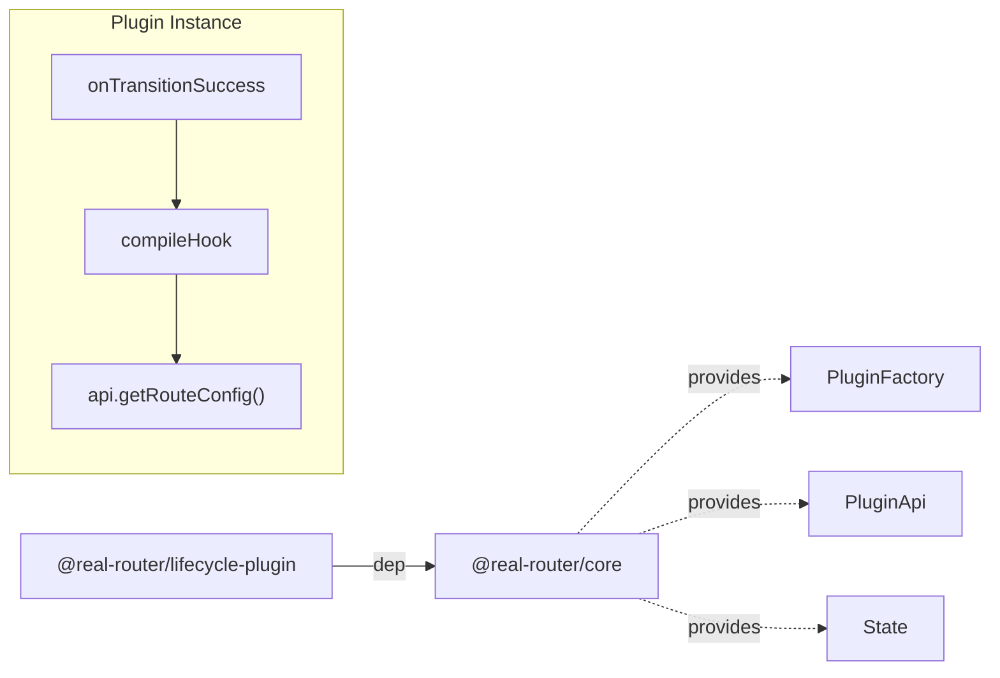

# Architecture

> Detailed architecture for AI agents and contributors

## Overview

`@real-router/lifecycle-plugin` is a **route-level lifecycle hooks plugin** for the router. It adds `onEnter`, `onStay`, `onLeave`, `onNavigate` callbacks to route definitions — declarative side-effects that fire on navigation events.

**Key role:** Bridges the gap between global plugin hooks (fire for every transition) and route guards (control flow). Lifecycle hooks are per-route side-effects — analytics, data prefetch, cleanup — without `subscribe()` boilerplate.

## Package Structure

```
lifecycle-plugin/
├── src/
│   ├── factory.ts    — compileHook (lazy compile + cache with factory invalidation),
│   │                   the two signal controllers, createPlugin, lifecyclePluginFactory
│   ├── types.ts      — LifecycleHook, LifecycleHookFactory types
│   └── index.ts      — Public exports + Route module augmentation
```

## Dependencies



| Import source              | What it uses                    | Purpose                    |
| -------------------------- | ------------------------------- | -------------------------- |
| **@real-router/core**      | `PluginFactory`, `State` types  | Plugin factory return type |
| **@real-router/core/api**  | `getPluginApi`, `PluginApi`     | Access route custom fields |

## Core Algorithm

### Hook Resolution

```
Navigation: home → users.view

onTransitionSuccess(toState, fromState)
    │
    ├── abort the previous commit's signal
    │
    ├── toState.name === fromState?.name?
    │   ├── YES → compileHook("onStay", "users.view") → call if resolved (commit signal)
    │   └── NO  → abort the left route's onEnter signal
    │             compileHook("onLeave", "home") → call if resolved (commit signal; no fromState → skipped)
    │             compileHook("onEnter", "users.view") → call if resolved (route signal)
    │
    └── compileHook("onNavigate", "users.view") → call if resolved (commit signal; orthogonal — always consulted)

onStop / teardown → abort both signals
```

`onNavigate` fires independently of `onEnter` / `onStay` — if both are defined, both fire. Each hook is dispatched based on its own condition.

### Lazy Compile + Cache Pattern

```typescript
compileHook(hookName: "onEnter" | "onStay" | "onLeave" | "onNavigate", routeName: string)
    │
    ├── Cache key: `${hookName}:${routeName}`
    │
    ├── api.getRouteConfig(routeName)?.[hookName] → factory reference
    │   ├── no factory → delete stale cache entry, return undefined
    │   ├── cache hit + factory === cached.factory → return cached.hook
    │   └── cache miss or factory changed → compile new hook
    │
    ├── Call factory: factory(router, getDependency) → LifecycleHook
    ├── Cache { hook, factory } in compiledHooks Map
    └── Return compiled hook
```

`router`, `getDependency`, `api`, and `compiledHooks` Map are captured once via closure in `createPlugin`. The compiled hook is reused on subsequent navigations as long as the factory reference stays the same.

### Factory Reference Cache Invalidation

The `compiledHooks` Map stores `{ hook, factory }` pairs. On every `compileHook()` call, the current factory reference from `getRouteConfig()` is compared against the cached `factory` via `===`. If the reference changed (e.g., after `getRoutesApi(router).replace(newRoutes)`), the old compiled hook is discarded and the new factory is compiled. This ensures HMR and dynamic route replacement work without plugin reinstallation.

Cost: one `getRouteConfig()` call per hook a commit consults — a `hasRoute` check and a property lookup on `routeCustomFields`. Reading the config on a cache miss only would keep serving a factory that `getRoutesApi(router).replace()` swapped out.

### Route Custom Fields

Custom fields are extracted automatically by core's `registerSingleRouteHandlers` in `routesStore.ts`. Standard fields — the members `Route` declares: `name`, `path`, `children`, `canActivate`, `canDeactivate`, `forwardTo`, `encodeParams`, `decodeParams`, `defaultParams`, `defaultSearch` — are excluded. Everything else, including `onEnter`, `onStay`, `onLeave`, `onNavigate`, lands in `routeCustomFields[routeName]`.

## Design Decisions

### Why every hook runs on the commit

All four hooks run from `onTransitionSuccess`; the plugin listens to no pre-commit event.

- Leave-approve is tentative: after it an activation guard can still refuse, a `subscribeLeave` listener can still fail the navigation, and the caller's `signal`, a newer navigation or `stop()` can still cancel it. The user then stays on the route, so cleanup run there would leave that route torn down — and a cancelled navigation followed by one that commits would run it twice.
- `onLeave` runs before the target's `onEnter` inside the same handler, which keeps "cleanup before enter"; the per-hook isolation keeps a throwing `onLeave` from swallowing the hooks after it.
- Work that must happen before the commit, or be undone when the navigation does not commit, has `router.subscribeLeave`, whose `signal` aborts in that case. `onLeave` runs only for a navigation that committed, so its own signal aborts only when the next one commits.

### Why two signal lifetimes

A hook's signal aborts when the work it started is superseded, and what supersedes it follows from when the hook runs again:

- `onStay`, `onNavigate` and `onLeave` answer one navigation, and the next commit is the next answer — they share one controller per commit, aborted there.
- `onEnter` answers the visit. A param or search change on the same route runs `onStay` and `onNavigate` but not `onEnter`, so aborting `onEnter`'s signal there would end work that nothing restarts. Its controller aborts when the route is left.
- `stop()`, `dispose()` and teardown abort both: after them no commit reaches the plugin.
- A navigation that does not commit aborts nothing — the user stays on the route, and the work is still wanted.

The price of the second lifetime is a load split between `onEnter` and `onStay`: the entry load's signal outlives the first `onStay` load, and the two race. Data that depends on params or search belongs in `onNavigate`, where the lifetimes agree.

A controller is opened by the first hook handed its signal, so a route without hooks pays nothing. The `ended` flag — set by `onStop` and teardown, cleared by the next commit — makes a controller opened after them within the same dispatch born aborted: a hook, or an abort listener, may stop the router while the rest of the commit's hooks still run.

### Why the abort reason is a fresh `AbortError`

`controller.abort()` without an argument gives every abort its own `DOMException` named `AbortError`, the name abort-aware code filters on — `fetch` rejects with it. A `RouterError` carries a different `name`. A shared reason has its `stack` rewritten by Node's `fetch` on every abort, and a frozen one — a frozen `State` included — makes Node's `fetch` reject with a `TypeError` instead of the reason. The price is the stack each `DOMException` captures, paid once per abort.

### Why no hooks for parent segments

Hooks fire only for `toState.name` / `fromState.name`, not for all segments in `transition.segments.activated` / `deactivated`. Reasons:

- Simpler mental model — one route, one hook call
- No loops, no Set allocations — just a property lookup
- Parent route hooks would fire on every child navigation, which is rarely desired

### Why `onNavigate` is orthogonal, not a fallback

`onNavigate` covers the most common pattern: run the same side-effect whenever the route is the navigation target (data loading, analytics, UI reset). Two dispatch designs are possible:

1. **Orthogonal** — fire `onNavigate` on every success, independently of `onEnter` / `onStay`.
2. **Fallback** — fire `onNavigate` only when the case-specific hook (`onEnter` or `onStay`) is absent for the current case.

The orthogonal design wins:

- **Matches the real-world hybrid example.** Chat route: `onEnter` connects the WebSocket, `onNavigate` loads messages. Under fallback semantics, `onNavigate` would not fire on entry (since `onEnter` is defined), forcing the user to duplicate `loadMessages` inside `onEnter` — exactly the duplication `onNavigate` exists to remove.
- **Mirrors global plugin hooks.** `onTransitionStart` and `onTransitionSuccess` coexist — neither silences the other. Route-level hooks follow the same model.
- **Simpler mental model.** Each hook fires based on its own condition. No priority rules, no fallback chains, no hidden interactions.
- **Composable.** Declaring `onEnter` alongside `onNavigate` cannot silently break the latter during refactors.

The only failure mode of orthogonal dispatch is the user declaring the same function in both `onEnter` and `onNavigate` — a user error; the fix is to keep only `onNavigate`.

### Why no configuration

The plugin has no options. The hooks themselves (defined on routes) are the configuration. Adding options like "fire for parent segments" would complicate both API and implementation for marginal benefit.

### Why per-hook try/catch (isolation)

Each hook's compile (factory) **and** invocation is wrapped in a per-hook `try/catch` that re-throws asynchronously via `queueMicrotask`. This exists for one reason: a throwing `onLeave`, `onEnter` or `onStay` — whether the **factory** throws at compile (a failing DI init) or the hook **body** throws at invocation — must not abort the `onTransitionSuccess` handler before the hooks after it run; otherwise the throw silently swallows them, `onNavigate` among them, breaking the orthogonality invariant. The `compileHook` call lives **inside** the `try`: passing a pre-compiled hook as the argument would evaluate the factory _before_ the `try` is entered — the `isolate(produce())` anti-pattern — leaking a compile-throw. Re-throwing on a microtask (rather than swallowing with `console.warn`) keeps the developer signal visible to global error handlers while every other hook of the transition still fires; the router continues operating regardless. This mirrors the per-listener isolation in `BaseSource` / `createActiveNameSelector` (`@real-router/sources`).

The trade-off: a throwing hook surfaces **asynchronously** (uncaught, via the microtask), not synchronously through the EventEmitter's "Error in listener" sink. The isolation is one local `runHook` helper applied to all four hooks, not a shared cross-package `invokeSafely` primitive: a shared helper cannot enforce its own adoption, and the error policy differs per context. A `no-restricted-syntax` rule in the root `eslint.config.mjs` refuses a call as `runHook`'s first argument — the `isolate(produce())` shape; it does not see a hook invoked outside `runHook`.

## See Also

- [core CLAUDE.md](../core/CLAUDE.md) — Core package architecture (PluginFactory, getRouteConfig)
- [core routesStore.ts](../core/src/namespaces/RoutesNamespace/routesStore.ts) — Custom fields extraction (`registerSingleRouteHandlers`)
- [preload-plugin ARCHITECTURE.md](../preload-plugin/ARCHITECTURE.md) — Same getRouteConfig + factory reference cache pattern
- [ARCHITECTURE.md](../../ARCHITECTURE.md) — System-level architecture
