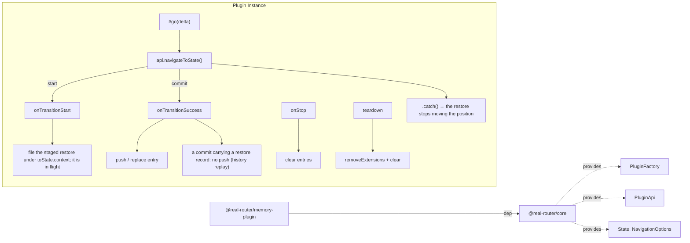

# Architecture

> Detailed architecture for AI agents and contributors

## Overview

`@real-router/memory-plugin` is an **in-memory history stack plugin** for the router. It maintains a `HistoryEntry[]` array and a current index, then exposes `back()`, `forward()`, `go(delta)`, `canGoBack()`, and `canGoForward()` as router extensions.

**Key role:** Provides browser-like history navigation without any dependency on `window.history`. Designed for React Native, testing environments, SSR navigation simulation, and any context where the browser History API is unavailable.

## Package Structure

```
memory-plugin/
├── src/
│   ├── factory.ts  — memoryPluginFactory: validates maxHistoryLength, freezes options, returns PluginFactory
│   ├── plugin.ts   — MemoryPlugin class: history array + index management, extendRouter, getPlugin()
│   ├── types.ts    — MemoryPluginOptions, HistoryEntry interfaces
│   └── index.ts    — Public exports + Router module augmentation
```

## Dependencies



| Import source             | What it uses                                                      | Purpose                          |
| ------------------------- | ----------------------------------------------------------------- | -------------------------------- |
| **@real-router/core**     | `PluginFactory`, `Plugin`, `Router`, `State`, `NavigationOptions` | Plugin types and router contract |
| **@real-router/core/api** | `getPluginApi`, `PluginApi`                                       | `extendRouter()` to add methods  |

## Core Algorithm

### History Management

```
Forward navigation: navigate("users", { id: "1" })
    │
    onTransitionSuccess(toState, fromState, opts)
    │
    ├── a restore record filed under toState.context?
    │   └── YES → the restore lands: #shown = its target, rewrite context
    │             with its direction, return (skip recording — replay)
    │
    ├── base = position (the target of a restore still in flight, else #shown)
    │   the restore in flight, if any, is cancelled by this commit
    │
    ├── opts.replace === true AND base >= 0?
    │   └── YES → #entries[base] = entry  (overwrite)
    │
    └── NO → splice(base + 1)              (discard forward history)
             push(entry)
             #shown = #entries.length - 1
             │
             └── maxHistory > 0 AND length > maxHistory?
                 └── YES → splice(0, overflow), adjust #shown
```

### Navigation Flow: `#go(delta)`

```
back() / forward() / go(delta)
    │
    └── #go(delta)
        │
        ├── delta === 0? → return (no-op)
        │
        ├── guard: delta === 0 || !Number.isFinite(delta) || !Number.isInteger(delta) → return
        ├── targetIndex = position + delta
        ├── targetIndex out of bounds? → return (no-op)
        │
        ├── entry.path === currentState.path AND no restore in flight?
        │   → #shown = targetIndex, return (short-circuit)
        │
        ├── restore = { targetIndex, direction }, staged for the call
        │
        └── api.navigateToState(entry, { replace: true, source, force on the current path })
            ├── START   → onTransitionStart files the restore under toState.context;
            │             it is in flight: position = its target
            ├── SUCCESS → onTransitionSuccess finds the record: the restore lands
            └── .catch()  → if it is still the restore in flight, it no longer is:
                               position = #shown
```

The restore record keeps `onTransitionSuccess` from recording the replayed navigation as a new history entry, and only the navigation that filed it carries it — a `navigate()` issued in the same tick as `back()`/`forward()`/`go()`, or committed while a guard holds the restore, is a fresh push. A guard-blocked or rejected replay never reaches `onTransitionSuccess`; its `.catch()` stops it moving the position, unless a newer restore has taken the position over or a navigation has committed over it.

## Data Flow

### Forward navigation

```
router.navigate("page", params)
    │
    [transition pipeline]
    │
    onTransitionSuccess(toState, _, opts)
    │
    ├── a restore record? NO
    ├── opts.replace? NO
    └── splice(base + 1) → push entry → #shown = base + 1
```

### Back / Forward

```
router.back()
    │
    #go(-1)
    │
    api.navigateToState(entry, { replace: true, source })
    │
    ├── START   → onTransitionStart files the restore: position = its target
    ├── SUCCESS → onTransitionSuccess finds the record: #shown = its target, no push
    └── BLOCKED → .catch() → the restore is no longer in flight:
                                position = #shown
```

### Guard blocks back navigation

```
router.back()
    │
    #go(-1)
    │
    api.navigateToState(...)  → START: position = the target
    │
    CANNOT_ACTIVATE (guard returns false)
    │
    .catch() → the restore is no longer in flight: position = #shown
    (onTransitionSuccess never fired, so the record was never consumed)

canGoBack() reflects the entry the router shows
```

## Design Decisions

### Why `void` not `Promise` for `back()`/`forward()`/`go()`

Plugin extensions registered via `extendRouter()` must be synchronous per the core contract — the router's type system expects `void` return values for these methods. The underlying `router.navigate()` call is async, but the result is discarded with `void`. Callers who need completion signals should subscribe to state changes before calling.

### Why `replace: true` in `#go()`

Navigating back or forward replays an existing history entry. Using `replace: true` keeps the replayed navigation from pushing a duplicate entry (even with the restore record in place, this is the correct semantic: the history position changes, not the history length).

### Why the stack position is derived, not reverted

The position `canGoBack()`/`canGoForward()` and the next `#go()` read is the target of the restore in flight, else the entry the router shows (`#shown`). Callers that inspect `canGoBack()`/`canGoForward()` while a `back()` is held see the post-navigation position, and a failed restore leaves nothing to undo: it stops being the restore in flight, and the position is the shown entry again. A refusal before the navigation is announced never made it the restore in flight, so it never moved the position at all.

### Why `go(0)` is a no-op

Delta zero means "navigate to the current entry." This would trigger a full transition to the same state, which core rejects with `SAME_STATES`. The early return avoids the unnecessary navigate call and the resulting error.

### Why `HistoryEntry` is not exported

`HistoryEntry` is an internal implementation detail. Callers interact with history through the five router extension methods (`back`, `forward`, `go`, `canGoBack`, `canGoForward`). Exporting the type would imply a public API surface that doesn't exist.

## Plugin Lifecycle

```
router.usePlugin(memoryPluginFactory(options))
    │
    memoryPluginFactory(options)
    ├── validate maxHistoryLength (throws TypeError if negative)
    └── freeze options
        │
        return PluginFactory
            │
            (router) => Plugin
                │
                getPluginApi(router)
                new MemoryPlugin(router, api, options)
                    └── api.extendRouter({ back, forward, go, canGoBack, canGoForward })
                        └── returns removeExtensions()
                │
                return plugin.getPlugin()
                    └── { onTransitionStart, onTransitionSuccess, onStop, teardown }

router.stop()
    └── onStop → #clear() (entries, shown index and the restore in flight reset, extensions remain)

router.usePlugin() unsubscribe / teardown
    └── teardown → #removeExtensions() + #clear()
```

## See Also

- [CLAUDE.md](CLAUDE.md) — Exports, gotchas, module structure
- [core CLAUDE.md](../core/CLAUDE.md) — Core package architecture (PluginFactory, extendRouter)
- [ARCHITECTURE.md](../../ARCHITECTURE.md) — System-level architecture
